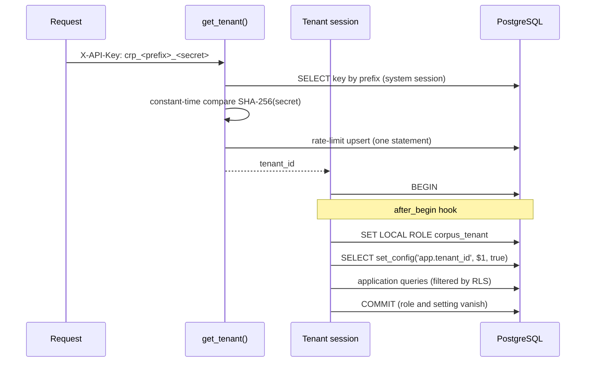
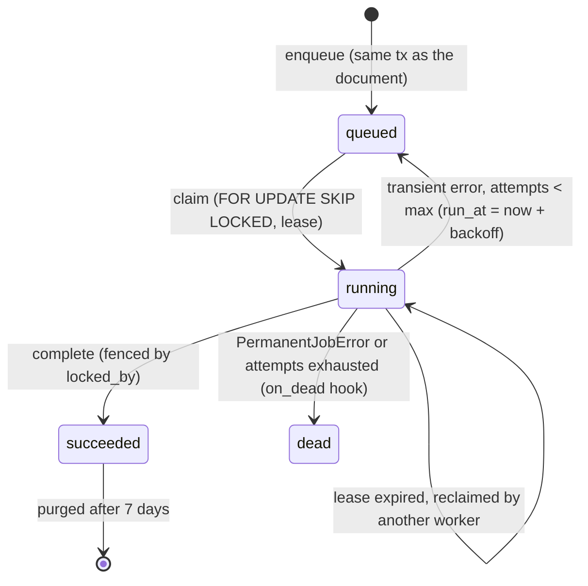
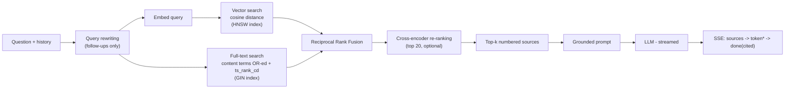

# Architecture

## Layers

```
src/corpus/
├── core/       Pure domain logic - no FastAPI, no SQL. Unit-tested in isolation.
│   ├── chunking.py     recursive, structure-aware splitter with overlap + page tracking
│   ├── embeddings.py   Embedder protocol + hash / fastembed / Voyage backends
│   ├── fusion.py       Reciprocal Rank Fusion
│   ├── prompting.py    grounded prompt, source rendering, citation extraction
│   ├── generation.py   AnswerGenerator protocol + streaming LLM implementation
│   └── api_keys.py     key format, generation, constant-time verification
├── db/         SQLAlchemy models, tenant-aware sessions (RLS context)
├── jobs/       Durable queue primitives and the worker runtime
├── services/   Use cases: tenancy & rate limiting, parsing, ingestion handler, retrieval
├── api/        FastAPI routes (public + admin), schemas, dependencies
├── evaluation/ corpus-eval: dataset, ranking metrics, retrieval and LLM-judged answer evaluation
├── observability/ Prometheus metrics, OpenTelemetry tracing, JSON logs, request ids
├── main.py     API process
└── worker.py   Worker process
migrations/     Alembic: the single source of truth for the schema, RLS policies and grants
observability/  Prometheus config and alerts, Grafana provisioning and dashboard
loadtest/       k6 scenario
```

Dependencies only point inward (`api -> services -> core`, `services -> db/jobs`). External
capabilities - embeddings and the LLM - sit behind `Protocol`s, so tests inject a deterministic
`HashEmbedder` and a `FakeGenerator`, and providers are swapped by configuration.

## Multi-tenancy

### Threat model

The dangerous bug in a multi-tenant SaaS is not an attacker breaking crypto; it is a developer
writing one query without `WHERE tenant_id = ...`. Corpus makes that bug harmless by enforcing
isolation **in PostgreSQL**, below the application:

| Layer | Mechanism | Protects against |
|-------|-----------|------------------|
| Authentication | API key -> tenant, revocable, hashed | Unauthenticated access, leaked DB dumps |
| Row-Level Security | policy `tenant_id = current_setting('app.tenant_id')` on every tenant table, for reads and writes | Missing filters, IDOR on ids from another tenant |
| Composite FKs | `(collection_id, tenant_id) REFERENCES collections (id, tenant_id)` | Cross-tenant links written by privileged code |
| API semantics | another tenant's resources return `404`, not `403` | Probing which ids exist |

### How the tenant context reaches PostgreSQL



The hook fires on **every** transaction of a tenant session, including the implicit one that
starts after a `commit()`, and both settings are transaction-local, so connections returned to
the pool are clean. `corpus_tenant` is a `NOLOGIN` role with only the DML grants it needs.

In development the API connects as the database owner and *drops* to `corpus_tenant` per
transaction. In production, connect with a dedicated non-owner login role as well, so that even
a SQL injection that ran `RESET ROLE` would not gain owner privileges.

### Rate limiting

A fixed one-minute window per tenant, stored in `rate_limit_counters` and charged with a single
`INSERT ... ON CONFLICT DO UPDATE ... RETURNING count`. It is atomic and correct with any number
of API replicas, without adding Redis to the stack. Old windows are purged by the workers.

## Job queue

### Why PostgreSQL rather than Redis/RabbitMQ?

Ingestion jobs must be created **atomically with the document they process**. With an external
broker, "insert document, then publish message" can fail halfway in either order (orphan
document, or a job for a row that was rolled back). In PostgreSQL the document, its content and
its job are one transaction. At the throughput of document ingestion (jobs that take seconds),
`SKIP LOCKED` queues comfortably handle thousands of jobs per second.

### Lifecycle



### Guarantees and how they are achieved

| Guarantee | Mechanism |
|-----------|-----------|
| A job is never run by two workers at once | `FOR UPDATE SKIP LOCKED` claim + lease |
| A crashed worker's job is not lost | lease expiry (`locked_until`) makes it claimable again |
| Long jobs are not stolen | heartbeat extends the lease every `lease / 3` |
| A zombie worker cannot overwrite the result | every transition is `WHERE locked_by = <me>` (fencing) |
| Retries do not hammer a failing dependency | capped exponential backoff with equal jitter |
| Retries do not duplicate data | the ingestion handler replaces chunks in one transaction |
| No duplicate active jobs | partial unique index on `idempotency_key` for active jobs |
| New jobs start immediately | `AFTER INSERT` trigger -> `pg_notify` -> worker `LISTEN` |
| The claim stays fast as history grows | partial indexes on ready / leased jobs only |

Execution is **at-least-once**: handlers must be idempotent, and the ingestion handler is.

## Ingestion

```mermaid
sequenceDiagram
    participant C as Client
    participant A as API
    participant DB as PostgreSQL
    participant W as Worker
    C->>A: POST /collections/{id}/documents (file)
    A->>A: validate type & size, sha256
    A->>DB: BEGIN; INSERT document, blob, job; COMMIT
    DB-->>W: NOTIFY corpus_jobs
    A-->>C: 202 Accepted (status=pending)
    W->>DB: claim job (lease)
    W->>DB: status=processing
    W->>W: parse (thread) -> chunk -> embed in batches
    W->>DB: BEGIN; DELETE old chunks; INSERT chunks; status=ready; COMMIT
    W->>DB: job succeeded
    C->>A: GET /documents/{id} (poll)
```

Parsing errors are deterministic, so they raise `PermanentJobError` (no retry, document marked
`failed`). Embedding/network errors are transient and retried with backoff.

## Question answering



### Why hybrid search?

Dense vectors capture meaning ("how long is the guarantee" ≈ "warranty period") but are weak on
exact identifiers - product codes, error numbers, names. Full-text search is the opposite. RRF
merges the two rankings using only rank positions, which avoids normalising scores that live on
incomparable scales. Both searches run concurrently, each in its own tenant session. The
measured effect of each stage is in [EVALUATION.md](EVALUATION.md).

### Why one PostgreSQL instead of a dedicated vector DB?

Documents, chunks, vectors, the full-text index and the job queue live in one transactional
store: deletions cascade atomically, RLS covers vectors too, and there is one thing to back up.
pgvector's HNSW index is fast enough well into the millions of chunks; a dedicated vector
database becomes worth its operational cost later, not on day one.

### Grounding and citations

Sources are numbered and wrapped in XML-escaped `<source>` tags, so a document cannot close the
tag and inject instructions. The system prompt requires inline `[n]` citations and an explicit
"not in the documents" answer. After streaming, the server parses the citations and returns only
numbers that refer to sources actually shown to the model.

## SSE protocol (`POST /v1/collections/{id}/chat`)

| event     | data                                                                 |
|-----------|----------------------------------------------------------------------|
| `query`   | `{"question": "...", "search_query": "..."}` - the query used for retrieval |
| `sources` | list of retrieved sources (number, filename, pages, content, score)  |
| `token`   | `{"text": "..."}` - incremental answer text                          |
| `done`    | `{"cited": [1, 3], "model": "...", "stop_reason": "...", "usage": {}}` |
| `error`   | `{"code": "refusal" \| "generation_failed", "message": "..."}`       |
